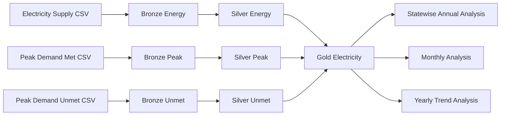

## ETL Pipeline – EnerLytics

EnerLytics uses an automated ETL (Extract, Transform, Load) workflow implemented in **Databricks using Apache Spark and PySpark**. The pipeline processes three electricity datasets through the Bronze, Silver and Gold layers of the Medallion Architecture.

### 1. Pipeline Workflow

The pipeline follows this structure:

### 2. Bronze Layer – Data Ingestion

The Bronze layer stores the three original electricity datasets in separate Delta tables:

- `bronze_energy` – Electricity supply data.
- `bronze_peak` – Peak demand met data.
- `bronze_unmet` – Peak demand unmet data.

The purpose of this layer is to preserve the original source information before applying transformations.

### 3. Silver Layer – Data Cleaning and Standardization

The raw datasets are processed using PySpark DataFrame operations.

The transformations include:

- Inspecting schemas and data types.
- Removing unnecessary empty state columns.
- Handling missing and unnecessary data.
- Standardizing column structures.
- Preparing datasets for integration.
- Validating dates and record consistency.

The cleaned datasets are stored in three separate Silver Delta tables:

- `silver_energy`
- `silver_peak`
- `silver_unmet`

### 4. Gold Layer – Data Integration

The three Silver datasets are integrated using their common date and state-level attributes.

The resulting consolidated dataset is stored in the Gold table:

`gold_electricity`

This layer contains structured and analysis-ready electricity data.

### 5. Analytical Outputs

The integrated Gold data is used to generate three analytical outputs:

1. **Statewise Annual Analysis:** Compares electricity indicators across different Indian states on a yearly basis.
2. **Monthly Analysis:** Helps examine monthly electricity supply and demand patterns.
3. **Yearly Trend Analysis:** Identifies changes and trends in electricity indicators over different years.

These outputs provide the foundation for SQL-based analysis and Power BI visualizations.

### 6. Pipeline Execution and Validation

The Databricks ETL pipeline was executed successfully, with all pipeline tasks completing successfully.

Initial data processing and validation produced the following results:

| Validation Metric | Result |
|---|---:|
| Processed daily records | 3,900 |
| Integrated dataset columns | 112 |
| Date mismatches | 0 |
| Empty state columns removed | 2 |

The validation checks confirmed consistent dates across all three source datasets, allowing them to be integrated reliably.

### 7. Technologies Used

- **Apache Spark:** Distributed data processing.
- **PySpark:** Data loading, cleaning and transformation.
- **Databricks:** Pipeline development and execution.
- **Delta Lake:** Structured data storage.
- **SQL:** Analytical querying and aggregation.
- **Power BI:** Data visualization and dashboard development.

The completed ETL pipeline transforms three separate raw electricity datasets into integrated analytical outputs, making the data ready for further exploration through Databricks SQL and Microsoft Power BI.
